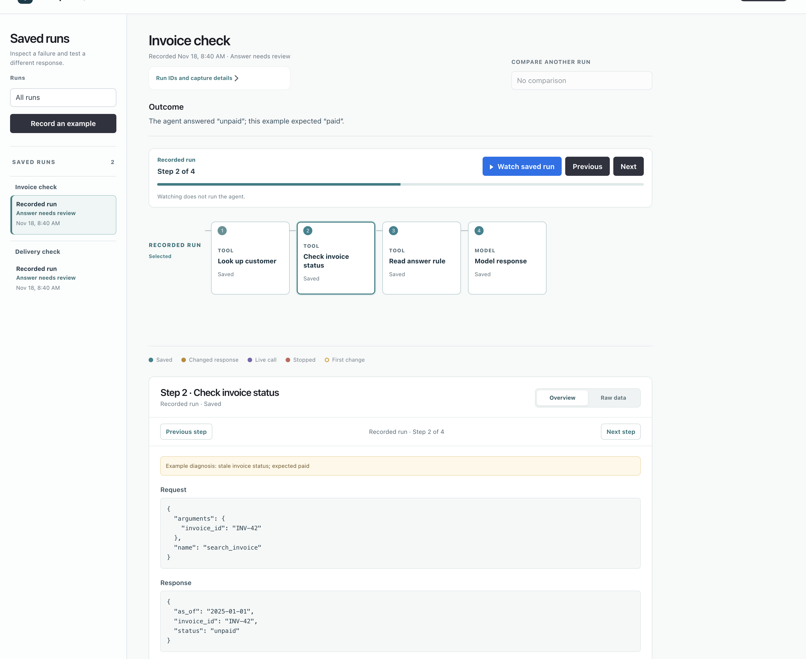

# Runsplice: deterministic agent replay

**Change one response. See where an agent run diverges.** Public beta.

Runsplice helps answer why a Python agent run failed and what changes after one model or tool response is corrected. In the bundled delivery example, the package tool reports `delivered` while the fixture model answers `in transit`. Replacing that answer produces `delivered` in a separate fork; the original run remains intact. [See the verified terminal output](docs/demo/terminal-demo.md).



This is an original recorded run, not a fork. The [evidence notes](docs/demo/evidence.md) describe the capture.

## Support at a glance

| Path | Record and inspect | Fork behavior | Requirements |
| --- | --- | --- | --- |
| Bundled delivery, invoice, and triage examples | Offline fixture runs | Strictly matched replay; changed requests block | Python 3.11+; Linux Docker engine for replay and fork |
| OpenAI Agents SDK wrapper | New sessions | Reuses matching calls; optional live continuation after divergence | `openai` extra and API key; live calls can cost tokens |
| Claude Agent SDK wrapper | New sessions | Live session branch with a changed tool result if the call recurs | `claude` extra and authentication; live calls can cost tokens |

The SDK wrappers do not import existing conversations. Offline replay makes no live model or tool calls. [SDK setup and limits](docs/SDK.md) explains the provider-specific behavior.

## Why this workflow

Logs and traces show what the original run did. Runsplice lets you test one changed model or tool response, preserve the original, and inspect the first difference. In the bundled offline examples, it supplies saved responses only while requests match; a changed request is marked `blocked`. That visible stop tells you exactly where the captured run can no longer establish an outcome. SDK forks have the separate guarantees shown above.

## Quick start: delivery run

From this checkout, use Python 3.11 or newer. These shell commands use a POSIX shell. Installation may need access to the package index for `setuptools`. The first recording needs no Docker engine or API key. `record` accepts only the three bundled example modules; use the [SDK wrappers](docs/SDK.md) for your own supported agent.

```sh
python3 -m venv .agentdbg/venv
. .agentdbg/venv/bin/activate
python -m pip install .
runsplice --store .agentdbg/store record --capture-content -- python -m agentdbg.delivery_example
runsplice --store .agentdbg/store runs
runsplice --store .agentdbg/store inspect RUN_ID --step 2
```

Copy `RUN_ID` from the `run <RUN_ID> answer=in transit expected=delivered` record line. `runs` shows `wrong_answer replayable=True`. Inspection shows that the `track_package` result was `delivered` in the model request, yet the recorded response was `in transit`.

With a Docker CLI connected to a Linux engine, try the unchanged replay and a corrected final response:

```sh
runsplice --store .agentdbg/store replay RUN_ID --from 1
runsplice --store .agentdbg/store fork RUN_ID --step 2 --response tests/fixtures/corrected-delivery-answer.json
runsplice --store .agentdbg/store diff RUN_ID FORK_ID
```

Copy `FORK_ID` from the fork output. The unchanged run and corrected fork end in `replayed`; the diff identifies the changed response at step 2 and shows `answer: in transit → delivered`. The original run remains intact. Docker may pull `python:3.11-slim` on first use.

See the [terminal demo](docs/demo/terminal-demo.md) for recorded output and verified Linux Docker replay, fork, and diff results for delivery and invoice.

**Captured content may contain private data.** `--capture-content` stores full requests, responses, state, and checkpoint files. Redaction may miss an unexpected secret or personal detail. Keep `.agentdbg/` private, inspect captures before sharing them, and avoid committing them. Metadata-only runs cannot replay.

## Other offline examples

Run these from the checkout with the installed `runsplice` command. Use a fresh store for each example, and replace the run and fork IDs printed by the commands.

**Invoice lookup:** step 2 has a stale `search_invoice` result dated `2025-01-01`, which reaches the model request at step 4. Correcting that tool response changes a later request, so the fork is expected to print `blocked` at the first unmatched request.

```sh
runsplice --store .agentdbg/invoice record --capture-content -- python -m agentdbg.example
runsplice --store .agentdbg/invoice inspect INVOICE_RUN_ID --step 2
runsplice --store .agentdbg/invoice inspect INVOICE_RUN_ID --step 4
runsplice --store .agentdbg/invoice replay INVOICE_RUN_ID --from 1
runsplice --store .agentdbg/invoice fork INVOICE_RUN_ID --step 2 --response tests/fixtures/corrected-tool-result.json
runsplice --store .agentdbg/invoice diff INVOICE_RUN_ID INVOICE_FORK_ID
```

**Support triage:** a ticket incorrectly says `low` priority. Correcting its first tool response to `high` changes the next `get_playbook` request, so this fork is also expected to print `blocked` at step 2.

```sh
runsplice --store .agentdbg/triage record --capture-content -- python -m agentdbg.triage_example
runsplice --store .agentdbg/triage inspect TRIAGE_RUN_ID --step 1
runsplice --store .agentdbg/triage replay TRIAGE_RUN_ID --from 1
runsplice --store .agentdbg/triage fork TRIAGE_RUN_ID --step 1 --response tests/fixtures/corrected-triage-ticket.json
runsplice --store .agentdbg/triage diff TRIAGE_RUN_ID TRIAGE_FORK_ID
```

Typical record lines are `answer=unpaid expected=paid` for invoice and `answer=routine expected=urgent` for triage. Unchanged replay prints `replayed` for both. Strict replay blocks these forks instead of making a live call or reusing a captured response for a different request. These are deterministic fixtures, not live invoice or support integrations.

## Run directly from the source tree

The Python module form, `python -m agentdbg.cli`, also works directly from the checkout without installation. For the other offline examples, replace the installed `runsplice` command with `python -m agentdbg.cli`; keep the example module after `--` unchanged.

The installed `runsplice` command works from another directory, but fixture paths above are relative to this checkout. On Windows with the Python launcher, the source-tree delivery record command is `py -3 -m agentdbg.cli --store .agentdbg\store record --capture-content -- py -3 -m agentdbg.delivery_example`. Docker Desktop must use Linux containers. Windows CI passed package installation, CLI help, and the unit suite, including source-tree recording. Docker-backed replay and storage ACLs have not been verified on Windows.

## Local visual timeline

After the quick start, run `runsplice --store .agentdbg/store ui` to open the local timeline. Keep the terminal open; press Ctrl-C to stop the server. The page binds to `127.0.0.1`, uses a fresh session token, and loads its component files locally. It lists every bundled offline example: invoice, triage, and delivery.

Choose a recorded run to inspect its outcome and relevant evidence. It opens at the first **Example diagnosis** when available, otherwise the first failed step, otherwise the final step. Diagnoses and expected answers belong to the bundled fixtures; SDK captures show observations without claiming a cause. The recorded outcome is followed by the timeline and playback, then the selected step’s evidence and actions. The selected step shows bounded request, response, and state-change previews before **Raw data**. Model steps have a collapsed **Context** section for message changes, byte counts, and repeated tool-output candidates. Byte counts are not provider token counts; Claude exposes submitted context, not its internal model context.

Response tests and unchanged replays appear beneath their recording, including replays of derived runs. Each derived run compares with its immediate source; copied overrides from earlier steps do not count as a new response edit. A response test opens on labeled recorded and test answers, outcome, edited response, first observed difference, first changed request, and execution stop. Moments at the same step are combined. The edited step opens automatically with up to five changed response or request fields. **Previous step** and **Next step** work without opening the timeline. **Raw data** contains the complete, separately labeled payloads; **Show full timeline**, above the selected-step evidence, expands aligned recorded and test steps in that position. A blocked request is a useful result: the corrected response changed the request, so replay cannot supply a saved response. It does not imply a new answer. An environment failure such as missing Docker is labeled as a replay diagnostic, not request divergence. Unconfirmed substitutions and limited captures state what cannot be established. An earlier difference in a live branch is not attributed to a later edited response.

Use **Test a different response** beside eligible recorded-step evidence. The JSON editor previews the replacement and explains the provider's guarantees before submission. Offline examples resume a saved checkpoint in Linux Docker without live calls. OpenAI SDK tests rerun a new session from the beginning, use saved responses while requests match, and stop at a changed request unless live continuation is explicitly allowed. Claude tool tests require acknowledgment of a live session branch; the selected tool call must recur, and model responses remain view-only. The original recording is preserved. Inapplicable actions show their reason. Live execution details and capture limits appear with the selected run rather than being implied by an offline label.

With a timeline visible, **Watch saved run** advances through saved steps without executing the agent. Pause or move one step at a time; selecting another step or run pauses playback. **Watch again** appears after the final step. On an empty store, **Choose an example** opens the recording dialog with debugging questions for invoice, support triage, and delivery. Full capture stays off until you opt in; without it, detailed evidence and replay are unavailable. Review captured requests, responses, state, and files before sharing the store. Recording your own SDK agent uses the integration instructions below.

The UI uses a self-hosted subset of Web Awesome Core 3.14.0 under its MIT license (`agentdbg/web/vendor/webawesome/LICENSE.md`). No Node tooling or network access is needed to use the installed UI.

## SDK integrations

New OpenAI Agents SDK and Claude Agent SDK sessions can be captured with opt-in wrappers. SDK forks have different guarantees from offline replay and may make billable live calls. See [SDK setup, fork workflow, limits, and troubleshooting](docs/SDK.md).

## How it works and limits

The [invoice](agentdbg/example.py), [triage](agentdbg/triage_example.py), and [delivery](agentdbg/delivery_example.py) examples call the [recording boundary](agentdbg/runtime.py) for each model or tool operation and checkpoint their JSON state. The [store](agentdbg/store.py) keeps run metadata in SQLite and captured payloads in content-addressed files. The [replay controller](agentdbg/sandbox.py) starts the recorded example in Docker and supplies captured responses only when the next operation and request hash match. The [reporter](agentdbg/report.py) reads saved runs for `inspect` and `diff`.

For compatibility, the Python import remains `agentdbg`, the old `agentdbg` command still works, and existing `.agentdbg` stores and `AGENTDBG_*` settings retain their names. `record` accepts only the three bundled example modules (or their Windows launcher forms); SDK apps use the [Python wrappers](docs/SDK.md). Bundled-example replay never makes live calls. The Docker worker has no network, a read-only root, and only a fresh run directory writable; this limits accidental effects and does not guarantee containment of hostile code. SDK live branches run in the invoking Python environment and do not use this Docker worker.

Without `--capture-content`, runs are metadata-only and cannot replay. `--redact-field FIELD` can be repeated for additional keys. Known credentials from environment variables and common authorization headers are redacted; files containing a known secret are omitted. Redacted, omitted, or truncated content needed for matching blocks replay. Each payload is limited to 1 MiB and each run to 100 MiB. POSIX storage permissions are private; protect a Windows store with a user-only ACL. `--store ROOT` selects the store, or set `AGENTDBG_STORE`; no `.env` file is required.

## Contributing and security

Run `python -m unittest discover -s tests -v`; Docker integration tests run when a Linux engine is available and otherwise skip. To check authenticated SDK behavior, follow the [SDK setup](docs/SDK.md), install both extras, set `AGENTDBG_LIVE_TESTS=1` and the provider credentials, then run `python -m unittest tests.test_sdk_live -v`. These optional tests make billable provider calls and are excluded from CI. See [CONTRIBUTING.md](CONTRIBUTING.md) for changes, [SECURITY.md](SECURITY.md) for private vulnerability reporting, and [the release checklist](docs/RELEASING.md) for versioning and verification. The project is licensed under [MIT](LICENSE).

The development history before this public snapshot remains available in the [Agent Replay Lab archive](https://github.com/weber-stephen/Agent-Replay-Lab).
