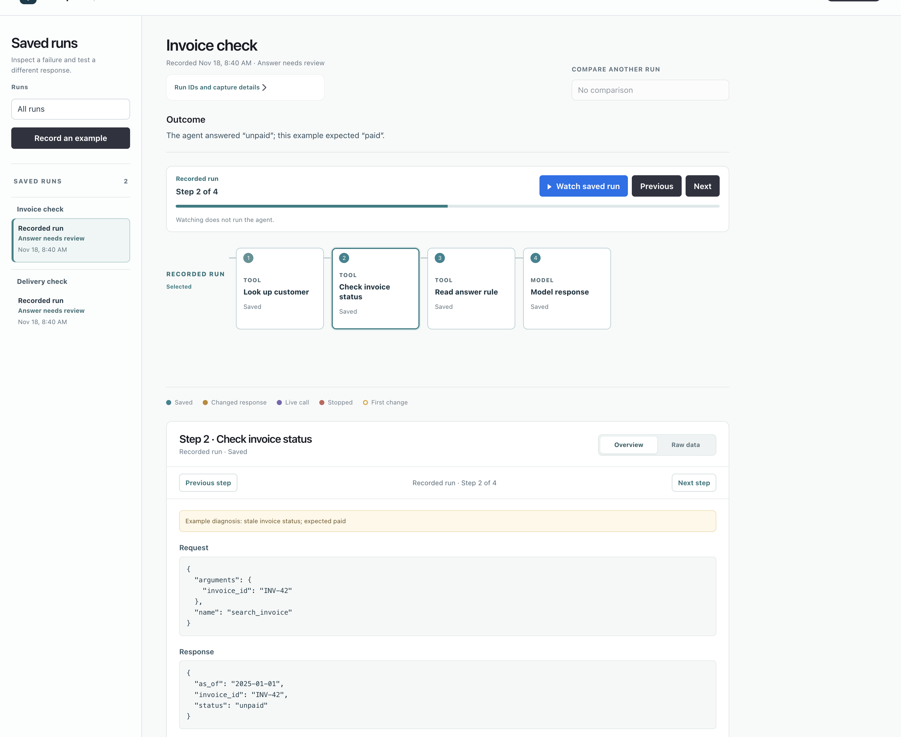

# Demo evidence notes

Screenshot annotations: **1.** The left rail shows the recorded invoice run. **2.** The outcome says the agent answered `unpaid` where the fixture expected `paid`. **3.** The timeline selects step 2, “Check invoice status,” and its evidence appears below the timeline with the stale recorded response. This is a direct browser screenshot of the local UI, without compositing or altered data.

Capture: after applying the Runsplice branding to the current UI, opened a freshly recorded invoice fixture in the local timeline and selected invoice step 2. The screenshot is a 3200 × 2620 PNG saved from that live browser tab. The companion [terminal demo](terminal-demo.md) preserves the CLI evidence and commands.

The screenshot shows a **recorded original run**, not a fork comparison. It includes only fixture data and no session token.

The screenshot was captured on a Mac without Docker. Separate [Linux CI evidence](terminal-demo.md#linux-docker-replay-and-response-experiments) verifies replay, fork, and diff for delivery and invoice. Authenticated SDK calls were not run.
